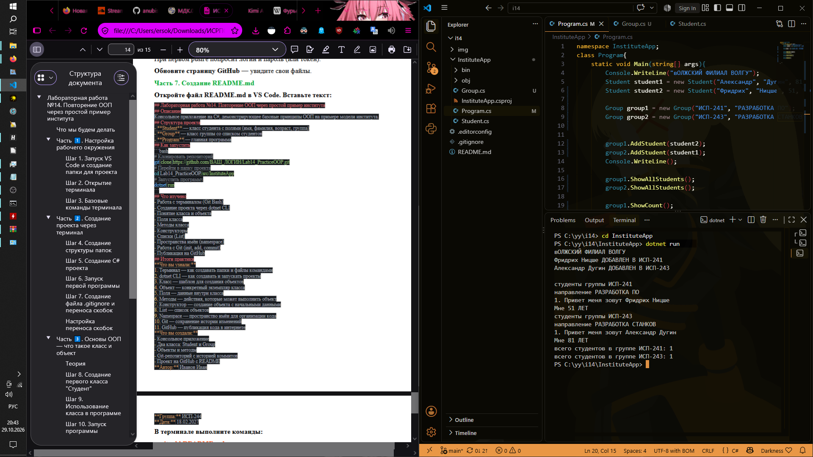
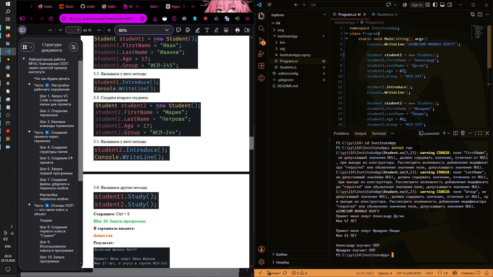

## ISRPO 14

## Описание
Консольное приложение на C#, демонстрирующее базовые принципы ООП на примере модели института.

___


**Автор:** Чумаченко Михаил
**Группа:** ИСП-242


## Структура проекта
- **Student** — класс студента с полями (имя, фамилия, возраст, группа)
- **Group** — класс группы со списком студентов
- **Program** — главная программа

___


## Как запустить
```bash
# Клонировать репозиторий
git clone < url >
# Перейти в папку проекта
cd InstituteApp
# Запустить программу
dotnet run
```

___


## Что изучено
- Работа с терминалом (Git Bash)
- Создание проекта через dotnet CLI
- Понятие класса и объекта
- Поля класса
- Методы класса
- Конструкторы
- Списки (List)
- Пространства имён (namespace)
- Работа с Git (init, add, commit)
- Публикация на GitHub
## Итоги практики
**Что вы узнали:**
1. Терминал — как создавать папки и файлы командами
2. dotnet CLI — как создавать и запускать проекты
3. Класс — шаблон для создания объектов
4. Объект — конкретный экземпляр класса
5. Поля — данные внутри класса
6. Методы — действия, которые может выполнить объект
7. Конструктор — создание объекта с начальными данными
8. List — список объектов
9. Namespace — пространство имён для организации кода
10. Git — сохранение истории изменений
11. GitHub — публикация кода в интернете
**Что вы создали:**
- Консольное приложение
- Два класса: Student и Group
- Объекты и методы
- Git-репозиторий с историей коммитов
- Проект на GitHub с README

___


## Скриншоты

